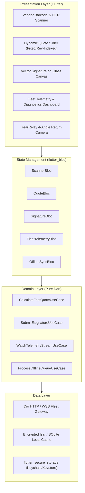

# GearLease Mobile Client — Design Specification

**Specification Date:** November 4, 2026  
**Status:** Under Review (Phase 3 Ideation & Design Gate)  
**Target Platform:** Flutter (iOS, Android, Tablet Floor Mode)  
**Source Documentation:** `product_requirement_document.md`, `system_design_document.md`, `technical_design_document.md`, `application_flow_specification.md`, `database_schema.md`, `ui_ux_design_specification.md`

---

## 1. Problem Statement & "How Might We"
> **How Might We** empower commercial equipment dealers and business lessees to originate lease agreements in under 90 seconds on noisy showroom floors and manage connected fleet telemetry in real time—with zero paperwork, zero data loss offline, and bank-grade biometric trust?

---

## 2. Recommended Direction & Architectural Blueprint

### 2.1 Core Architectural Approach
We adopt a **Clean Architecture + BLoC** pattern partitioned into three explicit layers:
1. **Presentation Layer**:
   - Modular Flutter widgets adhering to the *Utilitarian Industrial FinTech* design system (Dark Mode `#090D14`, Teal `#0D9488`, Amber `#F59E0B`).
   - BLoC/Cubit state management ensuring deterministic state transitions for underwriting, live fleet streaming, and offline sync.
   - Adaptive layouts supporting both mobile hand-held use (iPhone/Android) and showroom tablet floor presentation mode (iPad/Rugged Android tablet).
2. **Domain Layer**:
   - Pure Dart business logic, value objects, failure types, and use-case orchestrators (`CalculateFastQuote`, `CaptureInspectionAngle`, `SyncOfflineQueue`, `AuthenticateWithBiometrics`).
   - Zero framework dependencies to ensure 100% testability with unit tests.
3. **Data Layer**:
   - `Dio` client configured with TLS 1.3 certificate pinning, retry interceptors, and automated JWT token rotation.
   - Encrypted local persistence (`Isar Database` / `sqflite_sqlcipher`) implementing an offline-first sync queue with server-authoritative timestamps and UUIDv4 idempotency keys.
   - Hardware interfaces wrapped in clean abstraction contracts (`ICameraScannerService`, `IBiometricAuthService`, `ISignatureCaptureService`, `IWebSocketTelemetryService`).



---

## 3. Key Assumptions & Validation Gates

1. **Camera MLKit & Barcode Reliability**:
   - *Assumption*: High-density industrial barcodes (Code 128, DataMatrix) and Driver's License PDF417 codes can be scanned reliably in sub-optimal showroom lighting within 1.5 seconds.
   - *Validation*: Integrate `mobile_scanner` with custom scan window constraints and benchmark frame rate and decode latency on test hardware.
2. **Sub-90-Second Underwrite Pipeline**:
   - *Assumption*: Given an EIN and OCR identity payload, the BFF underwriting engine can return structured pricing tiers within 5–8 seconds, well within the 90-second total customer interaction goal.
   - *Validation*: Implement mock and real HTTP contracts with latency benchmarks and animated fallback states.
3. **Offline Sync & Conflict Safety**:
   - *Assumption*: Deals and inspection photos drafted in remote metal warehouse yards without cellular coverage will safely queue locally and sync with zero duplicate contracts once Wi-Fi/5G reconnects.
   - *Validation*: Test offline queue idempotency keys (`Idempotency-Key: <UUID>`) and verify mock network toggles in automated test suites.
4. **Impeller Engine 60/120 FPS Rendering**:
   - *Assumption*: Continuous real-time telemetry line charts and vector stroke signature rendering will maintain smooth 60/120 fps without jank on modern Flutter runtimes.
   - *Validation*: Profile widget rebuild counts and GPU frame times using Flutter DevTools.

---

## 4. Scope Boundaries (MVP vs Deferred)

### Included in MVP Scope (P0/P1)
- **Scaffolding & Core Architecture**: Clean Architecture directory structure, DI (`get_it`), App Theme, Routing (`go_router`).
- **Authentication & Security**: Phone OTP / mock KYB login, hardware-backed biometric unlock (`local_auth`), secure token storage.
- **Showroom Floor POS Flow**:
  - Optical barcode & QR scan (`mobile_scanner`).
  - Instant Quote Engine with dynamic term slider (36/48/60 mos) and pricing switch (Fixed vs Revenue-Indexed with Floor & Cap).
  - Digital Vector Signature Pad with stroke telemetry (timestamp, pressure points) and mock PDF preview.
- **Fleet Telemetry Dashboard**:
  - Live machine cards with operating hours, status tags (Optimal, Warning, Fault).
  - Telemetry diagnostics screen with real-time graphs (RPM, Temperature).
  - Mock WebSocket feed with simulated overheat alert triggers.
  - Deep link / 1-tap "Schedule Warranty Service" action.
- **Offline-First Sync Engine**:
  - Local sync queue model (`mobile_offline_sync_log`).
  - Network listener + background sync worker.
- **GearRelay 4-Angle Photo Inspection**:
  - Camera overlay masks for Front, Serial Tag, Engine Housing, Control Display.
  - Client-side image recompression prior to queue upload.

### NOT Doing in Initial MVP (Explicit Trade-Offs)
- **Direct Live Plaid SDK Link**: Deferred to v1.1. In MVP, we provide a secure hosted webview bridge and mock credential validation to avoid third-party sandbox friction.
- **Physical Bluetooth OBD-II / CAN-Bus Dongle Pairing**: Telemetry connects over cloud WebSocket (`wss://`) rather than direct local Bluetooth Low Energy (BLE) pairing.
- **Custom Native C++ MLKit OCR Pipeline**: Standard Flutter plugin (`mobile_scanner` + `google_mlkit_document_scanner`) will be utilized instead of building custom native iOS/Android C++ wrappers.

---

## 5. Architectural Boundaries & Component Interfaces

### 5.1 Quote Calculation API Contract
```dart
abstract class IQuoteRepository {
  Future<Either<Failure, QuoteCalculation>> calculateQuickQuote({
    required String assetBarcode,
    required String vendorOrgId,
    required int invoiceAmountCents,
    required String businessEin,
    required int termMonths,
    required RepaymentStructureType repaymentType,
  });
}
```

### 5.2 Offline Sync Contract
```dart
abstract class ISyncRepository {
  Future<Either<Failure, void>> enqueueSyncAction({
    required String actionType,
    required Map<String, dynamic> payload,
    List<File>? mediaFiles,
  });
  
  Stream<SyncQueueStatus> watchSyncStatus();
  Future<Either<Failure, int>> flushPendingQueue();
}
```

### 5.3 Real-Time Telemetry Contract
```dart
abstract class ITelemetryRepository {
  Stream<MachineTelemetryData> subscribeToMachineTelemetry(String assetId);
  Future<Either<Failure, void>> submitMaintenanceRequest({
    required String assetId,
    required String issueCategory,
    required String notes,
  });
}
```
